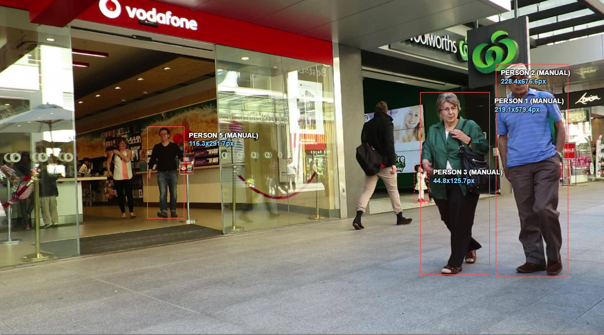
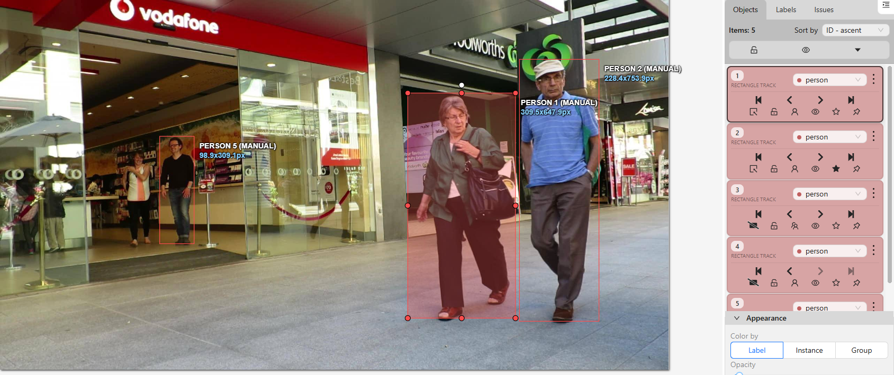
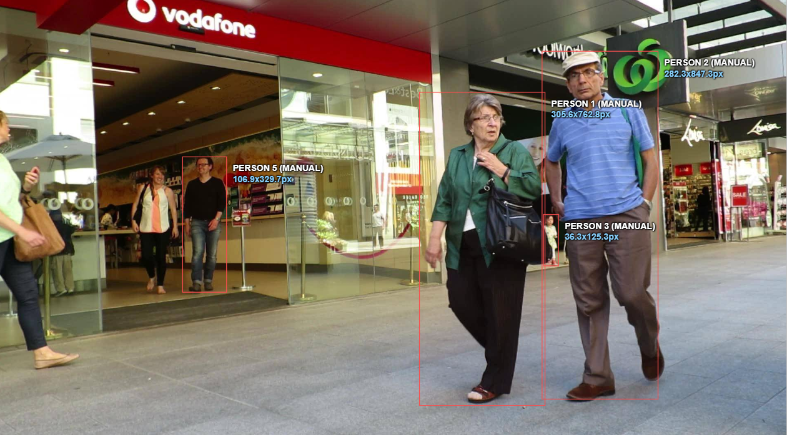

# Báo cáo cá nhân — PhamPhuNguyenHung-2A202604062

Đổi tên file theo quy tắc `MSSV_HoTen.md`. Ví dụ: `20241234_NguyenVanAn.md`.

Đoạn video: MOT17-09, 150 frame (frame 1–150), nguồn MOTChallenge, giấy phép CC BY-NC-SA 3.0.

## 0. Thông tin học viên

- Họ tên: Phạm Phú Nguyễn Hưng
- MSSV: 2A202604062
- Mã đề (A/B/C): B
- Email:hungphamphunguyen@gmail.com
- Link repository: https://github.com/phamphunguyenhung/K5-L2B-DAY05-PhamPhuNguyenHung-2A202604062-MOTTracking
- Giờ bắt đầu:16:15
- Giờ kết thúc:

## 1. Xem trước đoạn video (CP0)

Ghi **trước khi vẽ**, mỗi người một dòng.

| Mã | Frame xuất hiện | Frame cuối thấy được | Rẽ / dừng / đổi tốc độ ở frame | Bị che ở frame | Ghi chú |
|---|---|---|---|---|---|
| P1 |0 |140 |không |119-149 | |
| P2 | 0 | 149 | | không | Đi lại gần camera: box cao 338 → 834 px |
| P3 | 10| 149 | | không| Box cao 268 → 945 px |
| P4 | 0 | 144 | | 107–137 (khuất hẳn 111–134) | `outside` từ 145 |
| P5 | 0 | 104 | | 100 | `outside` từ 105; P4 và P5 đi sát nhau |

## 2. Keyframe và thời gian (CP1, CP4)

Số keyframe lấy từ kết quả `src/check_submission.py`.

| Mã | Số keyframe | Keyframe ở frame | Số frame có mặt | Keyframe / 100 frame | Thời gian (phút) | Chỗ khó |
|---|---|---|---|---|---|---|
| P1 | 15 | 0, 10, 20, 30, 50, 60, 70, 80, 90, 100, 110, 120, 130, 140, 149 | 150 | 10,0 | | |
| P2 | 18 | 0, 9, 10, 20, 30, 40, 50, 60, 70, 80, 90, 92, 102, 112, 122, 132, 142, 149 | 150 | 12,0 | | |
| P3 | 14 | 10, 20, 30, 40, 50, 60, 70, 80, 100, 110, 120, 130, 140, 149 | 140 | 10,0 | | |
| P4 | 12 | 0, 6, 19, 24, 43, 100, 106, 107, 110, 135, 138, 144 | 121 | 9,9 | | |
| P5 | 11 | 0, 3, 12, 20, 22, 36, 49, 100, 101, 102, 104 | 105 | 10,5 | | |
| **Tổng** | 70 | | 666 | 10,5 | | |

Keyframe / 100 frame của cả bài = tổng keyframe ÷ tổng số frame có mặt × 100 = 70 ÷ 666 × 100 ≈ 10,5

Bạn đặt keyframe nhiều nhất ở người nào? Vì sao (người đó rẽ, dừng, lại gần camera hay bị che)?

...

## 3. Đoạn bị che (CP2)

Người bị che: `P4` (bé gái áo xanh lá nhạt, bị bà áo xanh đậm đi ngang che; nhãn trên CVAT là "Person 3")

| Mốc | Frame |
|---|---:|
| Bắt đầu bị che một phần (bật `occluded`) | 107 |
| Mất hẳn (bật `outside`) | 111 |
| Hiện lại (tắt `outside`) | 135 |
| Thấy rõ trở lại (tắt `occluded`) | 138 |

- Thời gian khuất hẳn: 24 frame (111–134) = 0,8 giây (30 fps).
- Quyết định: giữ cùng ID.
- Lý do: Khuất hẳn 24 frame, ít hơn nhiều so với ngưỡng 60 frame (2 giây). Ngoại hình khớp: cùng bé gái, áo xanh lá nhạt, giày đỏ. Chỗ hiện lại gần đúng chỗ cũ, ngay sau bà áo xanh (box trước khi che ở x≈1316–1360, sau khi hiện lại ở x≈1328–1365), bé đứng gần như tại chỗ nên hướng và tốc độ khớp.

Ảnh chụp màn hình:





## 4. Tự review ID (CP3)

Lượt 1 theo người (đi ngược từ frame 149 về 0 trên CVAT), lượt 2 theo cảnh (nhảy 10 frame). Ít nhất 3 dòng; không có lỗi thì ghi một dòng "đã kiểm hai lượt, không lỗi".

Loại lỗi dùng đúng một trong 7 mã: `id_switch`, `fragmentation`, `lost`, `merge`, `false_track`, `drift`, `flag`.
đã kiểm 2 lượt không lỗi
đã kiểm 2 lượt không lỗi
đã kiểm 2 lượt không lỗi

| Frame | Mã người | Loại lỗi | Mô tả một câu | Phát hiện ở lượt | Đã sửa? |
|---:|---|---|---|---|---|
| | | | | | |
| | | | | | |
| | | | | | |

Tổng hợp số lỗi theo loại:0

| `id_switch` | `fragmentation` | `lost` | `merge` | `false_track` | `drift` | `flag` |
|---:|---:|---:|---:|---:|---:|---:|
| | | | | | | |

Lỗi nào chỉ lượt 2 (theo cảnh) mới thấy, lượt 1 (theo người) không thấy? Vì sao?
không có
...

## 5. File xuất và kết quả tự kiểm (CP4)

| Kiểm tra | Kết quả |
|---|---|
| Tên file MOT 1.1 | `src/exports/PhamPhuNguyenHung_mot.zip` |
| Tên file CVAT for video 1.1 | `src/exports/PhamPhuNguyenHung_cvat_video.zip` |
| Số track ID khác nhau trong `gt/gt.txt` (phải là 5) | 5 (666 box) |
| Frame `outside` không có dòng trong `gt.txt` (đúng / sai) | Đúng: P4 có 121 dòng (frame 0–144, vắng 111–134), P5 chỉ có 105 dòng (frame 0–104) |
| Job đã completed trên CVAT máy cá nhân | Đúng (job 15, state `completed`) |

Dán phần tóm tắt in ra từ `src/check_submission.py`:

```text
=== File MOT 1.1: PhamPhuNguyenHung_mot.zip ===
  Số track ID: 5   |   Tổng số box: 666
  [OK]        Đúng 5 track ID.

=== File CVAT for video 1.1: PhamPhuNguyenHung_cvat_video.zip ===
  Tổng: 70 keyframe / 666 frame có mặt = 10.5 keyframe / 100 frame
  [OK]        Đọc được 5 track từ annotations.xml.

=== Tóm tắt ===
  Lỗi: 0   |   Cảnh báo: 0
  Đạt.
```

## 6. Ba câu kết

1. Nếu được gán lại, bạn sẽ đặt keyframe khác ở đâu? Vì sao?

gán lại thì mình sẽ chọn cái mà góc khuất và ít thay đổi nhiều nhất trong cả video để gán để tăng tốc độ xử lý vì mấy cái này dễ sót
2. Có chỗ nào bạn không chắc "cùng ID hay ID mới"? Bạn đã quyết định và ghi chú thế nào?
mình nhầm id trong đề B vì hiện tại là file .html hướng dẫn 1 kiểu nhưng file check setup lab thì 1 kiểu, mình tuân theo file check setup lab vì nó đầy đủ và ghi đúng vị trí xuất hiện theo từng frame còn cái kia nó k có mô tả vị trí cụ thể D:\06-Learning\AIA-VINGROUP\learning\day05\labs\K5-L2-MOTTracking\src\lab_variants.json
   ...

3. Một lỗi ID trong job của bạn (nếu không còn sót, chọn lỗi đã sửa) có thể làm xe tự lái dự đoán sai chuyển động của người đó như thế nào? Lỗi đó ảnh hưởng MOTA hay IDF1 nhiều hơn?
Ở frame ~100–105, P4 và P5 đi sát nhau nên ID dễ đổi chỗ (id_switch). Nếu sót, bộ dự đoán sẽ ghép quỹ đạo người này với người kia, nên ước lượng vận tốc và hướng sai, xe có thể tưởng người đó sắp cắt ngang hoặc không dự đoán được họ dừng. Lỗi này chỉ tính 1 lần vào MOTA nhưng làm lệch ID suốt phần còn lại của track, nên ảnh hưởng IDF1 nhiều hơn.


   ...

## Bonus (nếu làm)

### B1 — Hai người đi sát

...

### B2 — So cách đặt keyframe

| Cách đặt | Số keyframe | Frame trôi nhất | Ghi chú |
|---|---:|---:|---|
| Đều mỗi 30 frame | | | |
| Theo chỗ đổi hướng | | | |

...

### B3 — So với tracker có sẵn

| Frame | Mã người | Tracker làm gì | Nhãn của bạn | Giải thích (đoán rồi sửa / ghép IoU / box score thấp / ngoại hình) |
|---:|---|---|---|---|
| | | | | |
| | | | | |

## 7. Tài liệu tham khảo và công cụ AI đã dùng

- Dữ liệu: MOT17 (MOTChallenge, Milan et al., 2016), CC BY-NC-SA 3.0, chỉ dùng trong lớp.
- **Claude Code (Anthropic), trợ lý AI dạng chat/CLI:** dùng để tạo task CVAT local và fork repo, kiểm tra mã đề (đề B, ID gốc 1, 19, 20, 21, 22 theo `src/lab_variants.json`), đọc track từ CVAT để điền số liệu mục 1 và mục 2, và kiểm tra lỗi ID bằng công cụ `mtm check`.
- **Nháp track bằng model (đã được giảng viên cho phép):** model `yolo26l-seg.pt` + tracker BoT-SORT bật ReID, chạy local trên CPU bằng công cụ `tools/mot-track-manager`. Sinh nháp cho **P4 (track #5)** và **P5 (track #6)**: 2 track, 21 keyframe; P1 P2 và P3 do tôi tự gán tay làm quen thao tác. Số keyframe và thời gian sửa tay sau nháp: 10 phút (điền khi hoàn tất).
- Claude Code cũng dùng để xác định đoạn bị che của P4 (xem lại từng frame 104–140) và điền mục 3 (CP2).
- Mục 4 (Tự review) và mục 6 (Ba câu kết) do tôi tự viết, không dùng AI.
